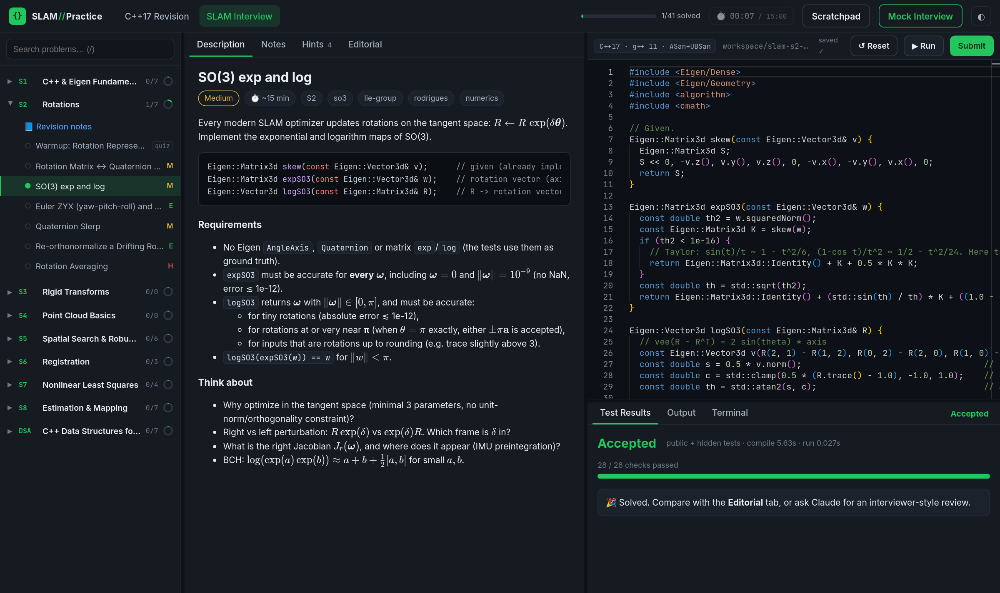
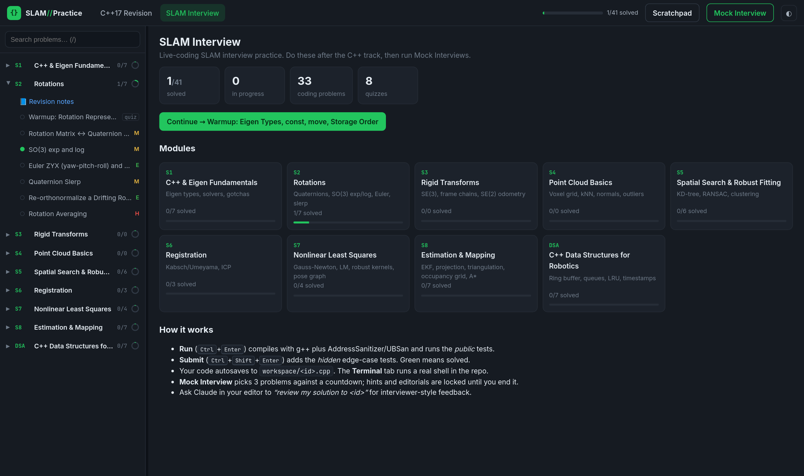
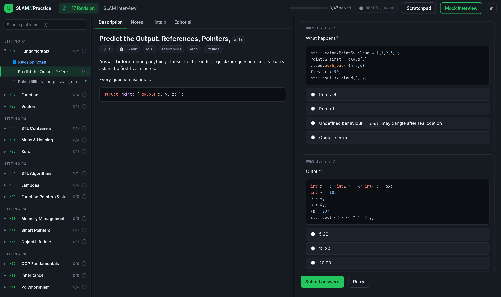

# SLAM//Practice

A local, HackerRank-style practice environment for **C++17 and SLAM live-coding interviews**. You get a problem list, a VS Code-style editor, a judge that compiles with **g++ + AddressSanitizer/UBSan**, public and hidden tests, quizzes, revision notes, a built-in terminal, and timed mock interviews.



## Quick start

```bash
./start.sh                 # starts the judge and opens http://127.0.0.1:8008
# or
python3 app/server.py --port 8008
```

**Requirements:** Linux, `g++` with C++17 (tested on g++ 11), Eigen 3.3+ in `/usr/include/eigen3`, and Python 3.8+ (standard library only). The editor, Markdown and math rendering load from cdnjs, so the browser needs internet access.

## What's inside

**118 problems** (88 coding + 30 quizzes) and **29 revision notes**: 60 problems in the C++17 track and 58 in the SLAM track. All are machine-verified.

| | |
|---|---|
| **C++17 Revision track** | 20 modules in 7 sittings: fundamentals → functions → vectors → containers → maps/sets → algorithms → lambdas → `std::function` → memory → smart pointers → Rule of 0/3/5 → OOP → inheritance → polymorphism → templates → C++17 features → advanced STL → multithreading → interview practice |
| **SLAM Interview track** | Eigen basics, rotations (quaternions, SO(3) exp/log, slerp), SE(3)/SE(2), point clouds (voxel grid, kNN, normals), KD-tree, RANSAC, clustering, Kabsch/ICP, Gauss-Newton/LM, pose graphs, EKF, projection, triangulation, occupancy grids, A*, plus robotics data structures |
| **Per module** | 📘 revision notes (memory/cost tables, pitfalls, rapid-fire Q&A) · a predict-the-output quiz · coding problems |
| **Per problem** | statement · starter code · public tests (**Run**) · hidden edge-case tests (**Submit**) · escalating hints · reference editorial |
| **Mock Interview** | 3 random problems against a 45/60-minute countdown. Hints and editorials stay locked until you end it, and you get a summary at the end |
| **Terminal** | a real shell in the repo (`./run.sh`, `git`, `cmake`, …) |
| **Scratchpad** | a free-form `main()` playground with the same flags and sanitizers |

<p>
  
  
</p>

## Keyboard

| Keys | Action |
|---|---|
| `Ctrl+Enter` | Run public tests |
| `Ctrl+Shift+Enter` | Submit (public + hidden tests) |
| `Ctrl+S` | Save now (it also autosaves) |
| `` Ctrl+` `` | Open the terminal |
| `/` | Search problems |

## Layout

```
app/server.py          judge + API (stdlib http.server, binds to 127.0.0.1 only)
app/static/            front end (Monaco editor, marked, highlight.js, KaTeX)
app/verify.py          validates every problem: starter compiles and fails; solution passes Run and Submit
problems/modules.json  tracks, modules and their order
problems/<id>/         meta.json · statement.md · starter.cpp · tests.cpp · solution.cpp   (or quiz.json)
notes/<MODULE>.md      revision cheat-sheets
common/check.h         CHECK / CHECK_NEAR / CHECK_MAT_NEAR / TEST_SUMMARY test macros
common/cloud_utils.h   synthetic clouds, random poses, timer (namespace cu)
workspace/             your answers (autosaved as <id>.cpp) and progress.json
run.sh                 ./run.sh file.cpp [-O]: compile and run any file with sanitizers
interviewer/           question bank for "Claude as live interviewer" sessions (spoilers!)
CLAUDE.md              interviewer protocol for Claude Code
```

## How judging works

Your code is prepended to the problem's `tests.cpp`:

```
g++ -std=c++17 -O0 -g -fsanitize=address,undefined -include workspace/<id>.cpp [-DHIDDEN] problems/<id>/tests.cpp
```

The result is one of: Accepted · Wrong Answer · Compilation Error (errors are underlined in the editor) · Memory/UB Error (sanitizer report) · Runtime Error · Time Limit Exceeded.

> GCC 11's ASan crashes at random on Linux 6.x kernels because of their address-randomization settings. The judge and `run.sh` work around this by running test binaries under `setarch -R`.

## Adding problems

See [problems/AUTHORING.md](problems/AUTHORING.md), then check your problem with:

```bash
python3 app/verify.py --module S4      # or: python3 app/verify.py <problem-id> ...
```

## Practising with Claude Code

Open the repo in Claude Code. [CLAUDE.md](CLAUDE.md) sets Claude up as a live interviewer:

- `start revision R1` / `start session 3` / `mock interview`: interactive sessions with follow-ups and scoring
- `review my solution to <id>`: interviewer-style feedback on your saved answer
- `review my mock: <id>, <id>, <id>`: a debrief after a mock interview

Scores and weak spots are tracked in [log/progress.md](log/progress.md).
